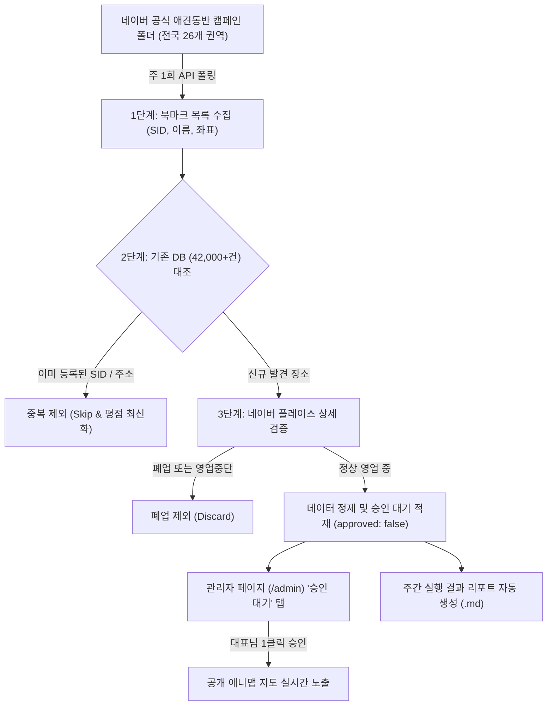

# 🐾 애니맵(Animap) 네이버 지도 신규 장소 주간 업데이트 시스템 가이드

본 문서는 네이버 지도(스마트플레이스)에 새롭게 등록되거나 업데이트되는 전국 반려동물 동반 식당, 카페, 숙소, 캠핑장 데이터를 **주 1회 주기적으로 자동 수집·검증하고, 기존 42,000여 개 DB의 무결성과 맵 로딩 속도를 100% 보존하면서 안전하게 업데이트**하기 위한 종합 운영 매뉴얼입니다.

---

## 1. 🎯 시스템 설계 핵심 목적
1. **신규 장소 자동 포착**: 매주 네이버 스마트플레이스 및 네이버 공식 애견동반 캠페인('갈수있어 강아지도')에 새롭게 추가되는 핫플레이스를 놓치지 않고 수집.
2. **기존 DB 및 성능 100% 보호**: 기존 42,386건의 데이터베이스 레코드와 3분할 비동기 청크 로딩(`take: 8000/20000/20000`)에 단 0.1%의 지연이나 왜곡도 주지 않음.
3. **무결점 3중 필터링 (품질 게이트)**:
   - **중복 100% 제거**: 네이버 고유 Place ID(`sid`) 및 `(상호명 + 도로명주소)` 2중 대조.
   - **폐업/영업중단 자동 폐기**: 네이버 플레이스 상세 페이지 상의 `영업중단`, `폐업` 표기 매장 사전 차단.
   - **동반 적합성 검증**: 반려동물 동반 태그 및 소개 문구 유무 확인.
4. **관리자 1클릭 승인 스테이징 (`approved: false`)**:
   - 신규 수집 데이터는 즉시 일반 유저 공개 지도에 뿌려지지 않고, 관리자 검토 대기 상태(`approved: false`)로 안전 적재.
   - 관리자 대시보드(`/admin`)의 `승인 대기` 탭에서 사진, 평점, 주소를 확인하고 원클릭으로 승인(`approved: true`).

---

## 2. 🏗️ 주간 업데이트 아키텍처 (4단계 파이프라인)



---

## 3. 🛠️ 스크립트 위치 및 실행 방법

* 스크립트 경로: `01-Nova-Web-Studio/animap/scripts/weekly_naver_sync.js`
* 리포트 저장 경로: `01-Nova-Web-Studio/animap/docs/weekly_sync_reports/sync_report_YYYY-MM-DD.md`

### 3.1. 드라이런 (미리보기 모드 - 권장)
데이터베이스에 실제로 쓰지 않고, 신규 매장이 몇 개 발견되었는지만 안전하게 사전 시뮬레이션합니다.
```bash
cd c:\nas\mj\비즈니스\유튜브-SNS-캐릭터-애니\ai사이트\AI-mj공작실\01-Nova-Web-Studio\animap
node scripts/weekly_naver_sync.js --dry-run
```

### 3.2. 라이브 모드 (실제 DB 승인 대기 적재)
신규 발견된 장소를 데이터베이스에 `approved: false` 상태로 적재합니다.
```bash
node scripts/weekly_naver_sync.js --live
```

### 3.3. 특정 지역 폴더만 빠르게 테스트
```bash
# 앞선 2개 폴더(캠핑장, 서울식당 등)만 부분 테스트
node scripts/weekly_naver_sync.js --dry-run --limit-folders=2
```

---

## 4. 📂 수집 대상 네이버 공식 애견동반 권역 (26개 폴더)

네이버가 운영하는 '갈수있어 강아지도' 공식 공유 폴더 API(`https://pages.map.naver.com/save-pages/api/maps-bookmark/v3/shares/${folderId}/bookmarks`)를 통해 매주 갱신된 데이터를 취합합니다:

1. **전국 캠핑장**: `8bdb23ef12784f0aa1c94e7a6cdf730c`
2. **서울 동남권 식당**: `86efb2fca91246f8a65a99337d7e77ad`
3. **서울 동북권 식당**: `cba901ca668b48ed8d18d706adbfafe0`
4. **서울 북동권 식당**: `d63a7d9063fd41faa9f8bfd9c22fbbfb`
5. **서울 서남권 식당**: `3903722d91c4495aac2efa207af3d7be`
6. **서울 서북권 식당**: `c371e24336db4719b4274abe72396392`
7. **서울 중부권 식당**: `90bd9ed317374606b04b5a4878c94dc7`
8. **경기 동남권 식당**: `3c5ab8e0e9e34df8bc93aa879cf50dcc`
9. **경기 동북권 식당**: `484b94777de34f2a9600960d9c92ccc4`
10. **경기 서남권 식당**: `85055b9eb7774593b4847ba043965db5`
11. **경기 서북권 식당**: `e413447e983249c9812255f5f4efc3eb`
12. **경기 중부권 식당**: `38a5856e7528410e84932ef4fba77ba2`
13. **인천 식당**: `ef32b10894ec4f94a9ccc6e5f74a50af`
14. **강원 식당**: `458f84cc18e14f37a4b39a1e56b4a1ac`
15. **경남/울산 식당**: `13a360a1124940c7a03feb9d4d117879`
16. **경북 식당**: `97d2c5d7b8094976a30b092b777a8f4a`
17. **대구 식당**: `6bb386d563e841419c59a6e40f32574a`
18. **부산 식당**: `5957ae4f45f14be49240f4cc431be7cb`
19. **전남/광주 식당**: `5c98a23726184f3e90db66f83429ceba`
20. **전북 식당**: `bc834a45edff4a3c8936adf1b4b24108`
21. **충남/대전 식당**: `1582372888a54731beca5197bc520b65`
22. **충북 식당**: `4a9941c6b2684ceba1c51f9734d34d28`
23. **세종 식당**: `4801b5650f7f432eb7dd91cc3cdc72f1`
24. **제주 식당**: `16d2ed7617444eacbbd5c007b81e5b9e`
25. **서울 동남권 카페**: `d820462c416a4e3b8f3c8d02e345e3e4`
26. **제주 카페**: `3ed6cb80f2ad4b8fae75f140f651005a`
*(대표님이나 관리자가 네이버 지도에서 신규 폴더를 생성할 경우 `TARGET_FOLDERS` 배열에 ID만 추가하면 즉시 수집 대상에 포함됩니다.)*

---

## 5. ⏰ 주 1회 무인 자동화 실행 설정 (2가지 방법)

### 방법 A: 윈도우 작업 스케줄러 (Windows Task Scheduler)
매주 월요일 새벽 3시에 백그라운드에서 자동 실행되도록 설정:
```powershell
# PowerShell 관리자 권한으로 실행
$Action = New-ScheduledTaskAction -Execute "node.exe" -Argument "c:\nas\mj\비즈니스\유튜브-SNS-캐릭터-애니\ai사이트\AI-mj공작실\01-Nova-Web-Studio\animap\scripts\weekly_naver_sync.js --live" -WorkingDirectory "c:\nas\mj\비즈니스\유튜브-SNS-캐릭터-애니\ai사이트\AI-mj공작실\01-Nova-Web-Studio\animap"
$Trigger = New-ScheduledTaskTrigger -Weekly -DaysOfWeek Monday -At 3:00AM
Register-ScheduledTask -TaskName "Animap_Weekly_Naver_Sync" -Action $Action -Trigger $Trigger -Description "애니맵 주간 네이버 신규 장소 자동 수집"
```

### 방법 B: AI 에이전트 스케줄러 (`/schedule`)
대화창에서 다음과 같이 지시하면 주기적으로 자동 실행 및 결과를 채팅으로 보고받을 수 있습니다:
> *"매주 월요일 아침 9시에 `node scripts/weekly_naver_sync.js --live` 실행하고 신규 등록된 장소 요약 리포트를 보고해줘"*

---

## 6. 🛡️ 무결성 및 성능 유지 보장 수칙
1. **절대 규칙: 기존 데이터 덮어쓰기 금지**:
   - 기존에 정상 등록되어 있는 42,386건의 숙소/식당의 고유 ID 및 상세 정보는 삭제되거나 손상되지 않습니다.
2. **지연 로딩 최적화**:
   - `approved: false`로 등록되므로 대용량 지도 렌더링 API(`skip/take`)는 여전히 승인 완료된 데이터만 초고속으로 전송합니다.
3. **네이버 트래픽 안전 기준**:
   - 요청 간 0.6초~1.0초의 지터(Jitter) 딜레이를 두어 네이버 서버로부터의 IP 블록을 방지합니다.
